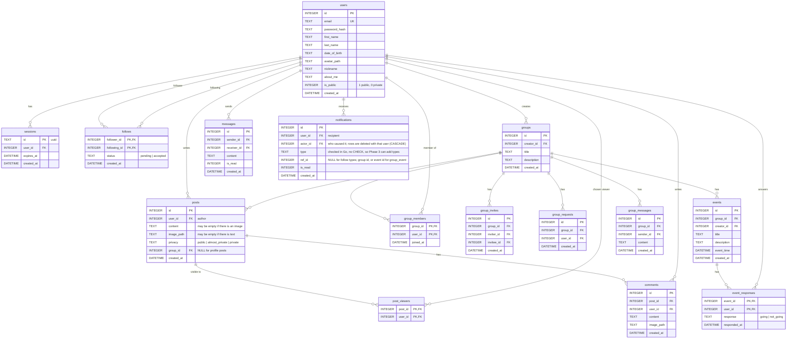

# Database ERD

Every table is created by a numbered migration in
`backend/pkg/db/migrations/sqlite`. Every table of Phases 0 to 3 exists; `messages` and
`group_messages` are added by Phase 4.

| Table | Migration added in |
|---|---|
| users, sessions | Phase 0 |
| follows | Phase 1 (migration 000003: the table only, so private profiles can check it. The follow endpoints are Phase 2) |
| posts, post_viewers | Phase 2 (migrations 000005, 000006) |
| comments | Phase 2 (migration 000007) |
| notifications | Phase 2 (migration 000004) |
| groups, group_members, group_invites, group_requests, events, event_responses | Phase 3 (migrations 000008 to 000013) |
| posts.group_id | Phase 3 (migration 000014: `ALTER TABLE posts ADD COLUMN`, so no merged migration is edited) |
| messages, group_messages | Phase 4 |

**Follow requests** are rows in `follows` with `status = 'pending'`, as in P2's
week-2 spec. There is no separate `follow_requests` table. Accepting a request
flips the row to `accepted`. Declining or cancelling deletes the row, so the
user can request again.

**Group invitations and join requests** work the same way: a row exists only
while it is pending, and answering (or cancelling a request) deletes it.
Joining either way also deletes the other one, so a member never has a stale
invitation or request. The creator is a row in `group_members` too.

**Group posts** are rows in `posts` with `group_id` set. Their `privacy` column
is stored as `public` but ignored: the group's members see them, nobody else.
Profile posts have `group_id` NULL.

## Constraints to remember

- Every child table uses `ON DELETE CASCADE` toward `users`, `posts`, `groups` and `events`.
- `UNIQUE (group_id, invitee_id)` on `group_invites` and `UNIQUE (group_id, user_id)` on `group_requests` block duplicates; `PRIMARY KEY (event_id, user_id)` on `event_responses` keeps one answer per member, and answering again updates it.
- `CHECK (title <> '')` and `CHECK (description <> '')` on `groups` and `events`; `CHECK (response IN ('going', 'not_going'))` on `event_responses`.
- `CHECK (follower_id <> following_id)` on `follows`, so nobody can follow themselves.
- Index every foreign key that is used in a `WHERE`, e.g. `follows(following_id, status)`, `posts(user_id)`, `posts(group_id)`, `messages(sender_id, receiver_id)`.
