# Database ERD

Every table is created by a numbered migration in
`backend/pkg/db/migrations/sqlite`. Every table of Phases 0 to 4 exists, including `messages` (private
chat) and `group_messages` (group chat).

| Table | Migration added in |
|---|---|
| users, sessions | Phase 0 |
| follows | Phase 1 (migration 000003: the table only, so private profiles can check it. The follow endpoints are Phase 2) |
| posts, post_viewers | Phase 2 (migrations 000005, 000006) |
| comments | Phase 2 (migration 000007) |
| notifications | Phase 2 (migration 000004) |
| groups, group_members, group_invites, group_requests, events, event_responses | Phase 3 (migrations 000008 to 000013) |
| posts.group_id | Phase 3 (migration 000014: `ALTER TABLE posts ADD COLUMN`, so no merged migration is edited) |
| messages | Phase 4 (migration 000015) |
| group_messages | Phase 4 (migration 000016) |
| otp_codes, users.is_verified | Email verification (migration 000017) |
| post_likes | Likes on posts (migration 000018) |
| idx_users_nickname (unique) | Unique nicknames (migration 000019) |
| otp_codes.purpose | Password reset (migration 000020: the table is rebuilt with the primary key `(purpose, subject)`) |
| password_reset_tokens | Password reset (migration 000021) |

A keys-only picture of the same diagram: [erd.webp](erd.webp).

**Follow requests** are rows in `follows` with `status = 'pending'`, as in P2's
week-2 spec. There is no separate `follow_requests` table. Accepting a request
flips the row to `accepted`. Declining or cancelling deletes the row, so the
user can request again.

**Group invitations and join requests** work the same way: a row exists only
while it is pending, and answering (or cancelling a request) deletes it.
Joining either way also deletes the other one, so a member never has a stale
invitation or request. The creator is a row in `group_members` too.

**Group posts** are rows in `posts` with `group_id` set. Their `privacy` column
is stored as `public` but ignored: the group's members see them, nobody else.
Profile posts have `group_id` NULL.

```mermaid
erDiagram
    users {
        INTEGER id PK
        TEXT email UK
        TEXT password_hash
        TEXT first_name
        TEXT last_name
        TEXT date_of_birth
        TEXT avatar_path
        TEXT nickname "optional ('' = none); unique ignoring case when set"
        TEXT about_me
        INTEGER is_public "1 public, 0 private"
        INTEGER is_verified "1 after the email code was confirmed"
        DATETIME created_at
    }
    otp_codes {
        TEXT purpose PK "verify_email | reset_password"
        TEXT subject PK "user:{id} (verify) or email:{address} (reset)"
        TEXT code_hash "sha256(salt + code), never the code"
        TEXT salt
        DATETIME expires_at
        INTEGER attempts
        DATETIME last_sent_at
    }
    password_reset_tokens {
        TEXT token_hash PK "sha256(token), never the token"
        INTEGER user_id FK
        DATETIME expires_at "15 minutes after the code was checked"
        DATETIME created_at
    }
    sessions {
        TEXT id PK "uuid"
        INTEGER user_id FK
        DATETIME expires_at
        DATETIME created_at
    }
    follows {
        INTEGER follower_id PK,FK
        INTEGER following_id PK,FK
        TEXT status "pending | accepted"
        DATETIME created_at
    }
    posts {
        INTEGER id PK
        INTEGER user_id FK "author"
        TEXT content "may be empty if there is an image"
        TEXT image_path "may be empty if there is text"
        TEXT privacy "public | almost_private | private"
        INTEGER group_id FK "NULL for profile posts"
        DATETIME created_at
    }
    post_viewers {
        INTEGER post_id PK,FK
        INTEGER user_id PK,FK
    }
    post_likes {
        INTEGER post_id PK,FK
        INTEGER user_id PK,FK
        DATETIME created_at
    }
    comments {
        INTEGER id PK
        INTEGER post_id FK
        INTEGER user_id FK
        TEXT content
        TEXT image_path
        DATETIME created_at
    }
    groups {
        INTEGER id PK
        INTEGER creator_id FK
        TEXT title
        TEXT description
        DATETIME created_at
    }
    group_members {
        INTEGER group_id PK,FK
        INTEGER user_id PK,FK
        DATETIME joined_at
    }
    group_invites {
        INTEGER id PK
        INTEGER group_id FK
        INTEGER inviter_id FK
        INTEGER invitee_id FK
        DATETIME created_at
    }
    group_requests {
        INTEGER id PK
        INTEGER group_id FK
        INTEGER user_id FK
        DATETIME created_at
    }
    events {
        INTEGER id PK
        INTEGER group_id FK
        INTEGER creator_id FK
        TEXT title
        TEXT description
        DATETIME event_time
        DATETIME created_at
    }
    event_responses {
        INTEGER event_id PK,FK
        INTEGER user_id PK,FK
        TEXT response "going | not_going"
        DATETIME responded_at
    }
    messages {
        INTEGER id PK
        INTEGER sender_id FK
        INTEGER recipient_id FK
        TEXT content "1-2000 characters, UTF-8"
        DATETIME created_at
        DATETIME read_at "NULL until the recipient reads it"
    }
    group_messages {
        INTEGER id PK
        INTEGER group_id FK
        INTEGER sender_id FK "a member when sent"
        TEXT content "1-2000 characters, UTF-8"
        DATETIME created_at
    }
    notifications {
        INTEGER id PK
        INTEGER user_id FK "recipient"
        INTEGER actor_id FK "who caused it; rows are deleted with that user (CASCADE)"
        TEXT type "checked in Go, no CHECK, so Phase 3 can add types"
        INTEGER ref_id "NULL for follow types; group id, or event id for group_event"
        INTEGER is_read
        DATETIME created_at
    }

    users ||--o{ sessions : has
    users ||--o| password_reset_tokens : resets
    users ||--o{ follows : "follower"
    users ||--o{ follows : "following"
    users ||--o{ posts : writes
    posts ||--o{ post_viewers : "visible to"
    users ||--o{ post_viewers : "chosen viewer"
    posts ||--o{ post_likes : "liked by"
    users ||--o{ post_likes : likes
    posts ||--o{ comments : has
    users ||--o{ comments : writes
    users ||--o{ groups : creates
    groups ||--o{ group_members : has
    users ||--o{ group_members : "member of"
    groups ||--o{ group_invites : has
    groups ||--o{ group_requests : has
    groups ||--o{ posts : "contains (posts.group_id)"
    groups ||--o{ events : has
    events ||--o{ event_responses : has
    users ||--o{ event_responses : answers
    users ||--o{ messages : sends
    users ||--o{ messages : receives
    groups ||--o{ group_messages : has
    users ||--o{ group_messages : writes
    users ||--o{ notifications : receives
```

## Constraints to remember

- Every child table uses `ON DELETE CASCADE` toward `users`, `posts`, `groups` and `events`.
- `UNIQUE (group_id, invitee_id)` on `group_invites` and `UNIQUE (group_id, user_id)` on `group_requests` block duplicates; `PRIMARY KEY (event_id, user_id)` on `event_responses` keeps one answer per member, and answering again updates it.
- `CHECK (title <> '')` and `CHECK (description <> '')` on `groups` and `events`; `CHECK (response IN ('going', 'not_going'))` on `event_responses`.
- `CHECK (follower_id <> following_id)` on `follows`, so nobody can follow themselves.
- `UNIQUE` index `idx_users_nickname` on `users(lower(nickname)) WHERE nickname IS NOT NULL AND nickname <> ''`: a nickname is unique without regard to case, and users without one (`''`) never clash.
- Index every foreign key that is used in a `WHERE`, e.g. `follows(following_id, status)`, `posts(user_id)`, `posts(group_id)`, `messages(sender_id, receiver_id)`.
