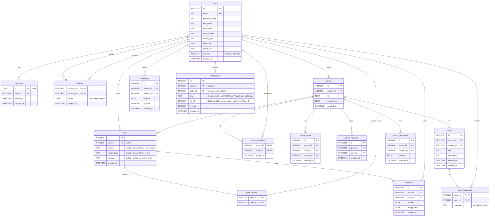

# Database ERD

Every table is created by a numbered migration in
`backend/pkg/db/migrations/sqlite`. `users`, `sessions`, `follows`, `notifications`, `posts`
and `post_viewers` exist so far; the rest are added by the phase that needs them.

| Table | Migration added in |
|---|---|
| users, sessions | Phase 0 |
| follows | Phase 1 (migration 000003: the table only, so private profiles can check it. The follow endpoints are Phase 2) |
| posts, post_viewers | Phase 2 (migrations 000005, 000006) |
| comments | Phase 2 |
| notifications | Phase 2 (migration 000004) |
| groups, group_members, group_invites, group_requests, events, event_responses | Phase 3 |
| messages, group_messages | Phase 4 |

**Follow requests** are rows in `follows` with `status = 'pending'`, as in P2's
week-2 spec. There is no separate `follow_requests` table. Accepting a request
flips the row to `accepted`. Declining or cancelling deletes the row, so the
user can request again.

## Constraints to remember

- Every child table uses `ON DELETE CASCADE` toward `users`, `posts`, `groups` and `events`.
- `UNIQUE (group_id, invitee_id)` on `group_invites` and `UNIQUE (group_id, user_id)` on `group_requests` block duplicates.
- `CHECK (follower_id <> following_id)` on `follows`, so nobody can follow themselves.
- Index every foreign key that is used in a `WHERE`, e.g. `follows(following_id, status)`, `posts(user_id)`, `posts(group_id)`, `messages(sender_id, receiver_id)`.
